# LinkedIn Messaging Automation — Phases 1, 2, 3, 4 & 5

A modular, Python-only messaging workflow automation system designed for reliable contact outreach, inbox history tracking, and response synchronization.

---

## Completed Architecture & Phases

- **Phase 1 — Project Foundation**: Configuration loader (`config.py`), SQLite database engine with SQLAlchemy 2.x ORM models (`models.py`, `database.py`), Excel workbook management (`excel_manager.py`), template engine (`template_manager.py`), and foundational test suite.
- **Phase 2 — Initial Sender Foundation**: Initial-message sender service (`sender/sender_service.py`), pluggable messaging adapter protocol (`sender/messaging_adapter.py`), deterministic mock adapter (`sender/mock_messaging_adapter.py`), contact eligibility filtering, persistent message state with idempotency keys, and dry-run execution.
- **Phase 3 — Reply Collector Foundation**: Replaceable reply-source interface (`collector/reply_source.py`), deterministic mock reply source (`collector/mock_reply_source.py`), record normalization, priority contact resolution, deduplication, SQLite persistence, `scraped_replies.xlsx` export, and workbook recovery.
- **Phase 4 — Entry Point 1 (Connections & Initial Sender Integration)**: Playwright browser lifecycle manager with safe context isolation (`browser/browser_manager.py`), connection-source interface (`connections/connection_source.py`), mock connection provider (`connections/mock_connection_source.py`), contact normalization/upserts, `contacts.xlsx` sync, and integrated initial outreach triggering (`connection_collector.py`).
- **Phase 5 — Entry Point 2 (Messaging Inbox & Conversation History)**: Replaceable conversation-source interface (`conversation/conversation_source.py`), deterministic mock conversation source (`conversation/mock_conversation_source.py`) with 14 test scenarios, message validation/normalization (`conversation/conversation_normalizer.py`), strict chronological ordering, priority-based contact resolution (`conversation/conversation_resolver.py`), SQLite bi-directional conversation history persistence (`models.ConversationMessage`), incoming reply synchronization (`models.Reply`), dual-sheet Excel synchronization (`ScrapedReplies` and `ConversationHistory`), and workbook recovery (`conversation_collector.py`).

> **Important**: This system uses deterministic mock adapters (`MockConversationSource`, `MockConnectionSource`, `MockMessagingAdapter`, and `MockReplySource`) by default. Live browser automation, unauthorized inbox scraping, private API exploitation, and platform-evasion techniques are strictly excluded.

---

## System Architecture

The automation engine is organized around two independent, decoupled entry points:

```mermaid
flowchart TD
    subgraph EP1["Entry Point 1: Connection Collection & Initial Outreach"]
        A1["Launch Browser Session (Playwright)"] --> B1["Fetch Connections (Mock / Authorized Source)"]
        B1 --> C1["Normalize & Upsert Contacts (SQLite)"]
        C1 --> D1["Synchronize contacts.xlsx"]
        D1 --> E1{"Outreach Flag Active? (--send)"}
        E1 -- Yes --> F1["Prepare Template & Send Initial Messages"]
        F1 --> G1["Persist Outcomes & Idempotency Keys"]
        E1 -- No --> H1["Clean Up Browser & Exit"]
        G1 --> H1
    end

    subgraph EP2["Entry Point 2: Inbox & Conversation History Collection"]
        A2["Fetch Inbox Threads (Mock / Partner API)"] --> B2["Normalize Messages & Timestamps"]
        B2 --> C2["Sort Chronologically by Thread"]
        C2 --> D2["Resolve Contacts (External ID -> Internal ID -> Name)"]
        D2 --> E2["Persist Full History (conversation_messages)"]
        E2 --> F2["Sync Incoming Replies (replies table)"]
        F2 --> G2["Export to scraped_replies.xlsx (Dual Sheets)"]
    end
```



---

## Directory Structure

```text
linkedin_automation/
├── main.py                     # Safe CLI entry point (Phase 1 initialization)
├── initial_sender.py           # Initial message sender CLI entry point (Phase 2)
├── reply_collector.py          # Reply collector & recovery CLI entry point (Phase 3)
├── connection_collector.py     # Connection collection & outreach CLI (Phase 4 / Entry Point 1)
├── conversation_collector.py   # Inbox & conversation history CLI (Phase 5 / Entry Point 2)
├── config.py                   # Centralized configuration & environment loader
├── database.py                 # SQLite engine, session manager & schema migrations
├── models.py                   # SQLAlchemy 2.x ORM models (Contact, Message, Reply, ConversationMessage, AutomationCycle)
├── excel_manager.py            # Atomic Excel operations (openpyxl), dual-sheet sync & workbook recovery
├── template_manager.py         # JSON template loader, placeholder validator & renderer
├── templates.json              # Standard response and outreach message templates
├── requirements.txt            # Python dependencies
├── .env.example                # Safe environment variable template
├── .gitignore                  # Git exclusions for secrets, databases, logs, and workbooks
├── README.md                   # System documentation
├── conversation/               # Conversation history collection package (Phase 5 / Entry Point 2)
│   ├── __init__.py
│   ├── conversation_service.py # Chronological ordering, persistence, reply sync & Excel export
│   ├── conversation_source.py  # ConversationSource abstract interface
│   ├── mock_conversation_source.py # 14 deterministic mock scenarios (ordering, direction, errors)
│   ├── conversation_normalizer.py# NormalizedMessage, direction resolution, timestamp parsing
│   ├── conversation_resolver.py# Priority-based contact resolution (external ID -> internal ID -> name)
│   └── conversation_exceptions.py# Domain exceptions hierarchy
├── browser/                    # Playwright browser lifecycle package (Phase 4)
│   ├── __init__.py
│   ├── browser_manager.py      # Lifecycle management, startup, navigation & cleanup
│   └── browser_exceptions.py   # Browser exceptions (startup, navigation, cleanup)
├── connections/                # Connection collection package (Phase 4 / Entry Point 1)
│   ├── __init__.py
│   ├── connection_service.py   # Connection retrieval, upserting, Excel sync & sender trigger
│   ├── connection_source.py    # ConnectionSource abstract interface
│   ├── mock_connection_source.py # Deterministic mock connection source
│   ├── connection_normalizer.py# Connection record validation & normalization
│   └── connection_exceptions.py# Domain exceptions
├── sender/                     # Initial message sender package (Phase 2)
│   ├── __init__.py
│   ├── sender_service.py       # Outreach workflow, eligibility filtering & transaction management
│   ├── messaging_adapter.py    # MessagingAdapter protocol & SendResult schema
│   ├── mock_messaging_adapter.py # Deterministic mock adapter for safe testing
│   └── sender_exceptions.py    # Custom domain exceptions
├── collector/                  # Reply collector package (Phase 3)
│   ├── __init__.py
│   ├── collector_service.py    # Collection workflow, contact resolution & Excel sync
│   ├── reply_source.py         # ReplySource abstract interface
│   ├── mock_reply_source.py    # Deterministic mock reply source
│   ├── reply_normalizer.py     # Record validation, timestamp parsing & whitespace cleanup
│   └── collector_exceptions.py # Domain exceptions
├── data/                       # Storage directory for SQLite and Excel workbooks
│   ├── .gitkeep
│   ├── linkedin_automation.db  # SQLite database (generated, git-ignored)
│   ├── contacts.xlsx           # Contacts master tracking sheet (generated, git-ignored)
│   ├── scraped_replies.xlsx    # Scraped replies workbook (generated, git-ignored)
│   └── automation_cycles.xlsx  # Cycle execution and outcome history (generated, git-ignored)
├── logs/                       # Application logs directory
│   ├── .gitkeep
│   └── automation.log          # Structured file log output (generated, git-ignored)
└── tests/                      # Automated pytest suite (105 tests passing)
    ├── __init__.py
    ├── test_conversation_collector.py # Entry Point 2 CLI tests
    ├── test_conversation_normalizer.py # Message validation, timestamps, direction tests
    ├── test_conversation_resolver.py # Priority resolution & ambiguity tests
    ├── test_conversation_service.py # Chronological ordering, deduplication, Excel sync tests
    ├── test_conversation_source.py  # Mock conversation source & error simulation tests
    ├── test_browser_manager.py # Playwright lifecycle, navigation, and cleanup tests
    ├── test_config.py          # Configuration loading & path resolution tests
    ├── test_connection_collector.py # Entry Point 1 CLI integration tests
    ├── test_connection_normalizer.py # Connection normalization tests
    ├── test_connection_service.py # Connection upsert, deduplication, and sender tests
    ├── test_database.py        # Database schema, foreign keys & transaction tests
    ├── test_excel_manager.py   # Workbook schema, atomic save & duplicate prevention tests
    ├── test_initial_sender.py  # Initial sender dry-run and CLI integration tests
    ├── test_messaging_adapter.py # Adapter contract & mock behavior tests
    ├── test_reply_collector.py # Reply collector CLI tests
    ├── test_reply_normalizer.py# Reply normalization & timestamp parser tests
    ├── test_reply_source.py    # Reply source interface & mock tests
    ├── test_sender_service.py  # Eligibility, template rendering, and DB/Excel persistence tests
    └── test_template_manager.py# Template loading, validation & placeholder tests
```

---

## Technology Stack

- **Python**: 3.11+ / 3.12+
- **Database & ORM**: SQLite 3 with SQLAlchemy 2.x
- **Spreadsheets**: `openpyxl` with atomic writes
- **Browser Automation**: `playwright` with session isolation
- **Configuration**: `python-dotenv` with immutable dataclasses
- **Testing**: `pytest`
- **Logging**: Python standard library `logging` with file and console handlers

---

## Installation & Setup

### 1. Clone & Set Up Virtual Environment

```bash
git clone https://github.com/amitraj18/Linekdin-Automation.git
cd Linekdin-Automation

# Create virtual environment
python -m venv .venv

# Activate virtual environment
# Windows:
.venv\Scripts\activate
# Linux/macOS:
source .venv/bin/activate
```

### 2. Install Dependencies

```bash
pip install -r requirements.txt
playwright install chromium
```

### 3. Configure Environment

Copy the example configuration to `.env`:

```bash
# Windows
copy .env.example .env
# Linux/macOS
cp .env.example .env
```

Adjust settings in `.env` as needed. All paths are resolved relative to the project root:
- `DATABASE_URL`: SQLite database connection string (default: `sqlite:///data/linkedin_automation.db`).
- `CONTACTS_WORKBOOK_PATH`: Path to contacts master Excel file.
- `SCRAPED_REPLIES_WORKBOOK_PATH`: Path to replies and conversation Excel file.
- `AUTOMATION_CYCLES_WORKBOOK_PATH`: Path to cycle logs Excel file.
- `TEMPLATES_FILE_PATH`: Path to outreach templates JSON file.
- `MESSAGING_ADAPTER`: Messaging backend (`mock` default).

### 4. Initialize Database & Workbooks

Run initialization to verify configuration, generate SQLite tables, and construct Excel workbooks with standard schemas:

```bash
python main.py --init
```

---

## Excel Workbook Responsibilities

| Workbook | Primary Worksheet(s) | Role & Pipeline Responsibility |
| :--- | :--- | :--- |
| `data/contacts.xlsx` | `Contacts` | Master record of contacts, external IDs, profile URLs, connection statuses, and outreach eligibility. Updated during Entry Point 1 collection and initial sender outreach. |
| `data/scraped_replies.xlsx` | `ScrapedReplies`<br>`ConversationHistory` | **Dual-purpose workbook**: <br>1. `ScrapedReplies`: Stores incoming replies formatted as input for the Phase 7 response engine.<br>2. `ConversationHistory`: Stores full bidirectional conversation messages with timestamps, direction, and sender information. |
| `data/automation_cycles.xlsx` | `CycleHistory` | Audit log of automation runs, execution counts, success/failure metrics, and error notes. |

---

## CLI Usage Guide

### Entry Point 1 — Connections & Initial Sender (`connection_collector.py`)

- **Dry-run mode** (fetch and validate connections without database or Excel changes):
  ```bash
  python connection_collector.py --source mock --dry-run
  ```

- **Collection only** (fetch connections, upsert into SQLite, sync `contacts.xlsx`, do not send messages):
  ```bash
  python connection_collector.py --source mock --limit 10
  ```

- **Collection & Initial Outreach** (fetch connections, sync contacts, and immediately send initial messages to eligible contacts):
  ```bash
  python connection_collector.py --source mock --send --sender-limit 5
  ```

### Entry Point 2 — Messaging Inbox & Conversation History (`conversation_collector.py`)

- **Dry-run mode** (simulate thread retrieval and contact resolution without modifying database or Excel):
  ```bash
  python conversation_collector.py --source mock --dry-run
  ```

- **Active Mock Collection** (retrieve threads, sort chronologically, persist messages, sync incoming replies, export to Excel):
  ```bash
  python conversation_collector.py --source mock
  ```

- **Filter by Conversation ID**:
  ```bash
  python conversation_collector.py --source mock --conversation-id MOCK_CONV_001
  ```

- **Rebuild Excel Workbook from SQLite**:
  ```bash
  python conversation_collector.py --rebuild-workbook
  ```

### Standalone Modules

- **Initial Message Sender (Phase 2)**:
  ```bash
  python initial_sender.py --dry-run
  python initial_sender.py --limit 5
  ```

- **Reply Collector (Phase 3)**:
  ```bash
  python reply_collector.py --source mock --dry-run
  python reply_collector.py --source mock
  python reply_collector.py --rebuild-workbook
  ```

---

## Testing & Quality Assurance

The project includes 105 automated unit and integration tests covering all 5 phases:

```bash
pytest -v
```

Test coverage includes:
- **Phase 1**: Configuration path resolution, schema creation, database transactions, Excel initialization, template placeholder validation.
- **Phase 2**: Sender eligibility filtering, idempotency keys, mock adapter outcomes, dry-run safety.
- **Phase 3**: Reply normalization, flexible timestamp parsing, contact resolution, workbook recovery.
- **Phase 4**: Browser context lifecycle, external session safety, connection upserts, sender integration.
- **Phase 5**: Conversation source contracts, 14 mock scenarios, message normalization and direction classification, chronological reordering, priority contact resolution, dual-sheet Excel sync, locked workbook isolation.

---

## Security Precautions & Compliance Feasibility

### Security Safeguards
1. **Zero Secret Leakage**: The repository excludes all `.env` files, databases (`*.db`), Excel files (`*.xlsx`), backups (`*.bak`), logs (`*.log`), and browser profiles via `.gitignore`.
2. **Safe Placeholders**: Configuration defaults use relative paths and mock adapters; no hardcoded personal or production credentials exist.
3. **Audit Trail**: Every message send is tracked with a deterministic idempotency key (`initial_msg_contact_{id}_{template_key}`) preventing duplicate outreach.

### Live-Source Feasibility Gate
- **Browser DOM Scraping Risks**: Extracting conversation histories from LinkedIn webviews via automated browser DOM scraping triggers anti-bot mechanisms, CAPTCHA challenges, and immediate session termination. Furthermore, LinkedIn's messaging web interface uses virtualized scrolling and dynamic class names that change without notice. Direct DOM scraping violates LinkedIn's User Agreement (Section 8.2).
- **Authorized Integration Path**: Production deployment requires access to LinkedIn's official Messaging and Compliance APIs via an authorized LinkedIn Developer or Enterprise Partner program. The `ConversationSource` abstract interface provides a drop-in contract that can seamlessly integrate an authorized OAuth2 API adapter without any changes to the core pipeline.
